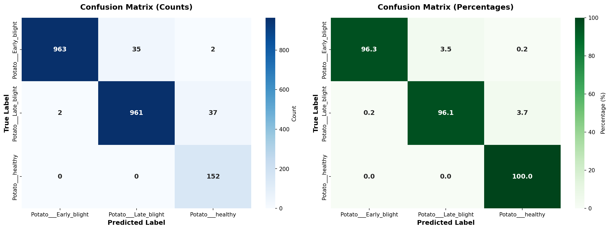
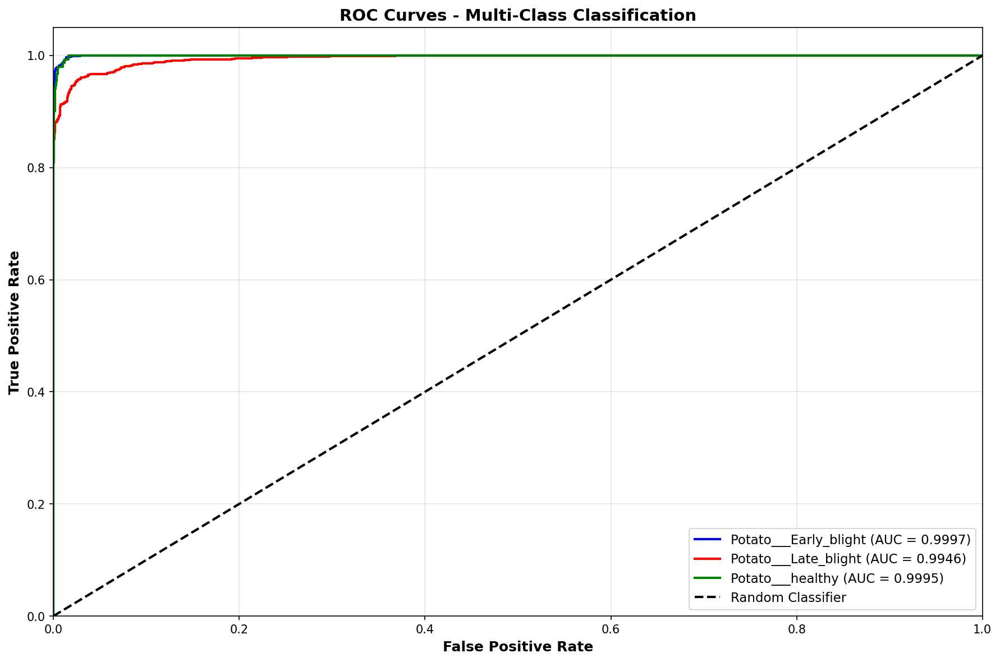
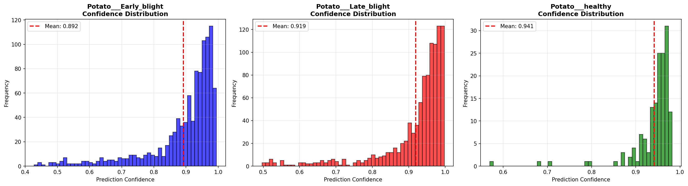

# PlantVillage Potato Disease Classification

Deep learning model for classifying potato plant diseases using convolutional neural networks (CNN).

## Project Overview

This project implements a memory-optimized CNN for classifying potato plant diseases into three categories:
- Potato___Early_blight
- Potato___Late_blight
- Potato___healthy

## Dataset

The dataset is structured with the following class distribution:
- Training samples: 1,722 images
- Validation samples: 430 images
- Total: 2,152 images

Class weights were applied to handle class imbalance:
- Potato___Early_blight: 0.7175
- Potato___Late_blight: 0.7175
- Potato___healthy: 4.7049

## Model Architecture

The improved CNN architecture includes:
- **Input**: 160x160 RGB images
- **Total Parameters**: 753,059
- **Architecture**: 4 convolutional blocks with batch normalization, dropout, and global average pooling
- **Dense Head**: 256 → 128 → 3 neurons with L2 regularization

### Model Specifications
- Conv2D layers: 48 → 96 → 192 → 256 filters
- Batch normalization for stable training
- Dropout rates: 0.2 → 0.3 (convolutional), 0.3 → 0.5 (dense)
- L2 regularization: 0.001
- Activation: ReLU (hidden), Softmax (output)

## Training Configuration

### Hyperparameters
- **Optimizer**: Adam (learning rate: 5e-5)
- **Loss**: Categorical Crossentropy with label smoothing (0.1)
- **Batch Size**: 8 (memory-optimized for GPU)
- **Epochs**: 100 (stopped early at 84)
- **Validation Split**: 20%

### Data Augmentation
- Rotation: ±30°
- Width/Height shift: ±20%
- Shear: ±20%
- Zoom: ±20%
- Horizontal/Vertical flip
- Brightness: 0.7-1.3
- Fill mode: reflect

### Callbacks
- ModelCheckpoint (save best model by val_accuracy)
- ReduceLROnPlateau (factor 0.5, patience 7)
- EarlyStopping (patience 20, restore best weights)
- CSVLogger (training history log)

## Training Results

### Final Performance
- **Best Validation Accuracy**: 96.79% (Epoch 63)
- **Training Accuracy at Best**: 91.23%
- **Training Loss at Best**: 0.7499
- **Validation Loss at Best**: 0.6599

### Training Progress
- Training converged steadily with validation accuracy improving from 46.5% to 96.8%
- Learning rate schedule: 5e-5 → 2.5e-5 (epoch 37) → 1.25e-5 (epoch 71) → 6.25e-6 (epoch 80)
- Early stopping triggered after 20 epochs without improvement
- Total training time: 84 epochs

#### Training History


#### Training Confusion Matrix


### Class Performance
The model achieved balanced performance across all three classes with the confusion matrix showing:
- High precision and recall for all disease classes
- Minimal confusion between Early blight and Late blight
- Excellent healthy plant detection

#### Detailed Classification Report

| Class | Precision | Recall | F1-Score | Support |
|-------|-----------|--------|----------|---------|
| Potato___Early_blight | 99.79% | 96.30% | 98.02% | 1,000 |
| Potato___Late_blight | 96.49% | 96.10% | 96.29% | 1,000 |
| Potato___healthy | 79.58% | 100.00% | 88.63% | 152 |
| **Overall Accuracy** | - | - | - | **96.47%** |
| **Macro Avg** | 91.95% | 97.47% | 94.31% | 2,152 |
| **Weighted Avg** | 96.83% | 96.47% | 96.55% | 2,152 |

#### Confusion Matrix

| Actual \ Predicted | Early Blight | Late Blight | Healthy |
|-------------------|--------------|-------------|---------|
| Early Blight | 963 | 35 | 2 |
| Late Blight | 2 | 961 | 37 |
| Healthy | 0 | 0 | 152 |



#### Additional Metrics

- **Total Correct Predictions**: 2,076 / 2,152 (96.47%)
- **Total Misclassifications**: 76 (3.53%)
- **Early Blight Accuracy**: 96.30% (963/1000)
- **Late Blight Accuracy**: 96.10% (961/1000)
- **Healthy Accuracy**: 100.00% (152/152)
- **Average Confidence Scores**:
  - Early Blight: 89.20%
  - Late Blight: 91.90%
  - Healthy: 94.14%

#### ROC Curves


#### Confidence Distribution


## Model Artifacts

### Training Artifacts
- **Best Model**: `outputs_potato_improved/best_model.h5` (9.15 MB)
- **Training Log**: `outputs_potato_improved/training_log.csv`
- **Confusion Matrix**: `outputs_potato_improved/confusion_matrix_improved.png`
- **Training History**: `outputs_potato_improved/training_history_improved.png`

### Inference Results
- **Classification Report**: `inference_results/classification_report.csv`
- **Per-Class Metrics**: `inference_results/per_class_metrics.csv`
- **Confusion Matrix (Detailed)**: `inference_results/confusion_matrix.csv`
- **Confusion Matrix (Plot)**: `inference_results/confusion_matrix_detailed.png`
- **ROC Curves**: `inference_results/roc_curves.png`
- **Confidence Distribution**: `inference_results/confidence_distribution.png`
- **All Predictions**: `inference_results/all_predictions.csv`
- **Misclassifications**: `inference_results/misclassifications.csv`

## Hardware Requirements

- **GPU**: Required (tested with CUDA-enabled GPU)
- **Memory**: Optimized for limited GPU memory
- **TensorFlow**: 2.10.0

## Usage

### Training
Run the training notebook:
```bash
jupyter notebook Potato.ipynb
```

### Inference
Load the best model:
```python
from tensorflow import keras
model = keras.models.load_model('outputs_potato_improved/best_model.h5')
```

## Optimizations

1. **Memory Efficiency**: Reduced batch size (8) and image size (160x160) to fit in GPU memory
2. **Regularization**: L2 regularization and dropout to prevent overfitting
3. **Class Balancing**: Computed class weights for imbalanced dataset
4. **Label Smoothing**: Reduces overconfidence and improves generalization
5. **Learning Rate Scheduling**: Adaptive learning rate reduction for convergence

## Future Improvements

- Experiment with transfer learning (ResNet, EfficientNet)
- Implement data augmentation pipeline with tf.data
- Add cross-validation for robust evaluation
- Deploy model as web service for real-time inference
- Expand to other plant diseases

## License

This project uses the PlantVillage dataset for research purposes.
